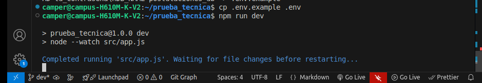
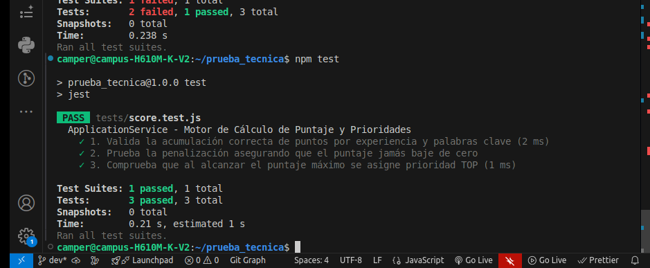

## Autor Evelyn Barrios 

## Proyecto de API REST en Node.js y Express 

para la gestion de postulaciones laborales, integrando motor de calculo automatico de puntajes, prioridades y reglas de negocio sobre base de datos relacional.

# Requisitos Previos
Node.js version 18 o superior instalado.

Gestor de base de datos SQL (MySQL o SQLite segun configuracion).

Instalacion y Configuracion
Clonar el repositorio y ubicarse en la carpeta del proyecto.

Instalar las dependencias del proyecto ejecutando el siguiente comando en la terminal:

Bash

npm install
Crear el archivo de entorno basandose en la plantilla de ejemplo:

Bash

cp .env.example .env
Configurar las variables de conexion a la base de datos dentro del archivo .env.

Ejecutar el script SQL ubicado en database.sql dentro de su gestor de base de datos para crear las tablas e insertar los datos de prueba obligatorios.

Ejecucion del Proyecto
Para iniciar el servidor en entorno de desarrollo:

´´´Bash

npm run dev
Para iniciar el servidor en produccion:

´´´Bash

npm start
Ejecucion de Pruebas Automatizadas
Para correr las pruebas unitarias del motor de puntaje:

´´´Bash

npm test
Documentacion de Endpoints
1. Registrar Postulacion
Ruta: POST /applications

Descripcion: Valida la existencia del candidato, el estado abierto de la vacante, aplica la regla de duplicidad por tiempo y estado, calcula el puntaje de forma automatica y almacena la postulacion con prioridad y estado inicial.

Cuerpo de solicitud (JSON):

JSON

{
  "candidateId": 1,
  "vacancyId": 1,
  "source": "REFERRAL",
  "coverLetter": "Tengo experiencia desarrollando APIs con Node.js y bases de datos SQL"
}
2. Consultar Postulaciones
Ruta: GET /applications

Descripcion: Retorna el listado de postulaciones ordenadas por puntaje de mayor a menor y fecha de creacion ascendente. Soporta filtros opcionales por query params status y vacancyId.

3. Cambiar Estado de Postulacion
Ruta: PUT /applications/:id/status

Descripcion: Actualiza el estado de una postulacion especifica validando restricciones de estados finales.

Cuerpo de solicitud (JSON):

JSON

{
  "status": "IN_REVIEW"
}
.env.example
Fragmento de código

PORT=3000
DB_HOST=localhost
DB_USER=root
DB_PASSWORD=tu_contrasena
DB_NAME=postulaciones_db

## pruebas

## se realizaron pruebas

